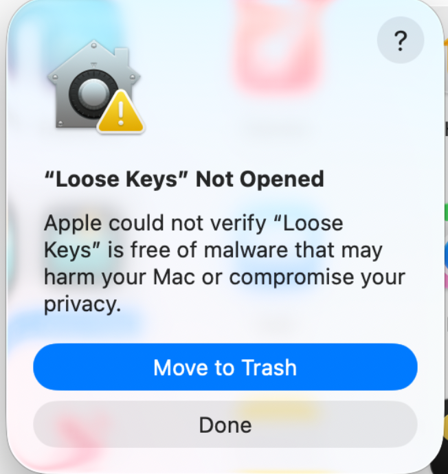
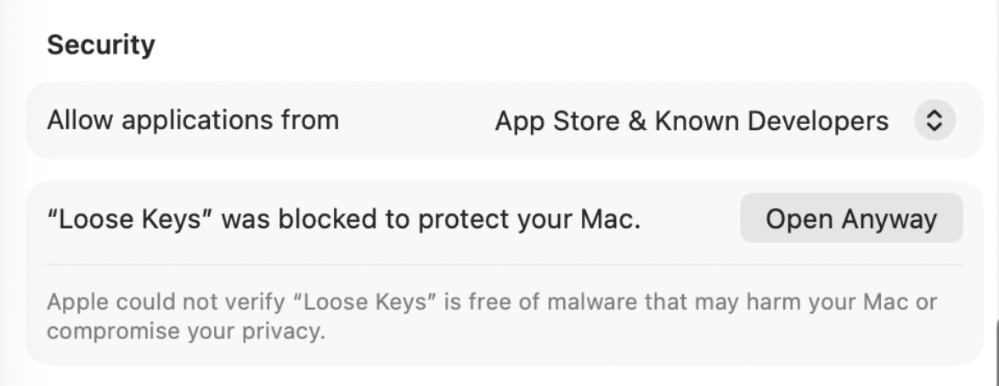

# Loose Keys

Loose Keys is a Mac app that finds credentials left in plain files. It checks
your home folder and any other folders or drives you add.

It looks for password exports, private keys, API tokens, saved sign-ins, and
secrets left by AI agents. For each finding, it explains what it found and how
to deal with it.

Loose Keys never changes the files it scans, and it goes online only to
check for a new version, if you let it.

Version 0.10.0 · MIT licensed

## Install the beta

Loose Keys requires a Mac with Apple silicon and macOS 14 or later.

1. Download the app from the [latest release](https://github.com/chuglo/loose-keys/releases/latest).
   To check the download, run `shasum -a 256` on it and compare the result
   with that file's checksum in the release notes.
2. Unzip it and move **Loose Keys** to Applications. If the release includes a
   `.dmg`, you can open it instead, drag **Loose Keys** onto its **Applications**
   shortcut, and eject the disk.
3. Open Loose Keys from Applications.

The beta isn't notarized by Apple, so macOS will block it the first time you
open it. Click **Done**:



Then open **System Settings › Privacy & Security**, scroll to **Security**, and
click **Open Anyway** beside the message about Loose Keys. Confirm when asked:



Choose **Scan Now** for a first check. Then turn on **Scan Automatically**, on
the Overview, so Loose Keys keeps checking after you close the window.

## Guides

- [Using the app](docs/usage.md): the window's controls and what to do with a finding.
- [Detection and limits](docs/detection.md): what the scanner finds, what it doesn't report and where it looks.
- [Deploying to managed Macs](docs/managed.md): for IT administrators: how to run the command as root, what the counts files hold, and how to list expected findings.

## Use the command line

The app includes a `loose-keys` command for one-time scans in a terminal or
script. To put it on your `PATH`, link it into `/usr/local/bin`. Then run a scan:

```sh
sudo mkdir -p /usr/local/bin
sudo ln -s "/Applications/Loose Keys.app/Contents/MacOS/loose-keys" /usr/local/bin/
loose-keys scan
```

The command uses the same scanner as the app, but it doesn't read the app's
saved state. Findings you set aside in the app still appear in the command's results.

```sh
loose-keys scan --limits                  # also print what the scan can't detect
loose-keys scan --select /Volumes/Backup  # include another folder or drive
loose-keys scan --exclude ~/Archive       # skip a folder (up to 32)
loose-keys scan --fail-on-open high       # exit with 3 if anything high is open
loose-keys scan --export report.json      # full JSON report
loose-keys scan --feedback counts.json    # counts only, no paths
loose-keys --list-rules                   # every rule and where it looks
```

[Detection and limits](docs/detection.md#choosing-folders-on-the-command-line)
explains what `--select` and `--exclude` accept.

Run `loose-keys --help` for the other options. The exit codes are:

- 0: the scan is complete.
- 1: the scan is partial, because something couldn't be checked.
- 2: an error.
- 3: you gave `--fail-on-open LEVEL` (`high`, `medium` or `low`), and something
  worth reviewing is at that risk level or above.

Exit codes don't depend on what the scan found, unless you give
`--fail-on-open`. If more than one applies, 2 wins over 3, and 3 wins over 1.

`--fail-on-open` counts only what's worth reviewing. A stored sign-in counts
once its file's permissions let other users read it. A test-mode key never
counts.

The summary goes to standard output. So do JSON written to `-` and the output of
`--help`, `--version` and `--list-rules`. Errors go to standard error. If you
mistype the command, the usage text goes there too, and the exit code is 2.

The summary says what a finding concerns, such as the AWS profile or registry
host. The JSON report leaves that out and names only the kind of token. Its
fields are in the [JSON report schema](schema/report-1.schema.json).

The command writes the export file only when the scan ends, and always as a new
file. If the file already exists or can't be created, the command writes
nothing and prints no summary. The exit code is 2.

A full report contains file paths. A counts file leaves out paths, but it still
shows which kinds of credentials you have. Check either file before you share
it. The app's **Save Counts Only…** writes the same counts file. To see what a
counts file holds, or to run the command as root from a device-management tool,
see [Deploying to managed Macs](docs/managed.md).

When you scan from a terminal, macOS may ask whether your terminal app can open
protected folders such as Desktop, Documents and Downloads. The scan waits for
your answer (unverified). If macOS refuses a place, the scan lists it as "Access
denied by macOS". The scan then counts as partial and exits with 1. To include
those places, allow the terminal app in **System Settings › Privacy &
Security**, under **Files & Folders** (unverified). Then scan again.

## Build the app

You'll need Rust 1.88 or later and Apple's command-line developer tools.

```sh
sh gui/build-macos.sh
open "target/release/bundle/macos/Loose Keys.app"
```

The build signs the app ad hoc unless `LOOSE_KEYS_SIGN_IDENTITY` names a
code-signing identity. An ad-hoc identity changes with every build, and that can
stop the background helper from working after a rebuild (unverified). An Apple
Development identity stays the same. If you plan to rebuild, sign with one from
the first install. To see yours, run `security find-identity -v -p codesigning`.
Then build with it:

```sh
LOOSE_KEYS_SIGN_IDENTITY="Apple Development" sh gui/build-macos.sh
```

To keep the app, move it to Applications. To make a disk image with a
drag-to-Applications shortcut, run `sh gui/package-dmg.sh`. It writes
`target/release/bundle/macos/Loose-Keys-<version>.dmg`. It won't overwrite an
existing image.

## Development

This repository is one Cargo workspace. The scanner is a library in `src/`,
and the `loose-keys` command sits on top of it. The app's engine, in `gui/`,
links into a Swift window.

Before you make changes, read [AGENTS.md](AGENTS.md) and the
[development standards](docs/development/standards.md). All checks run
locally. [Local checks](docs/testing/local-verification.md) lists them.

- [All documentation](docs/README.md)
- [Reporting a security problem](SECURITY.md)
- [License](LICENSE) and [third-party notices](THIRD_PARTY_NOTICES)
