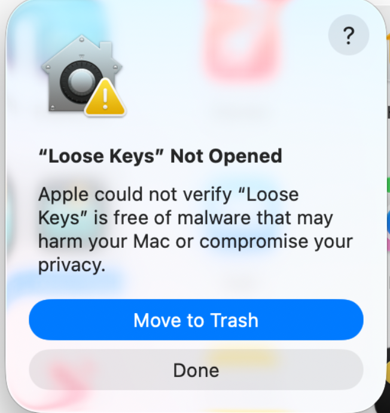
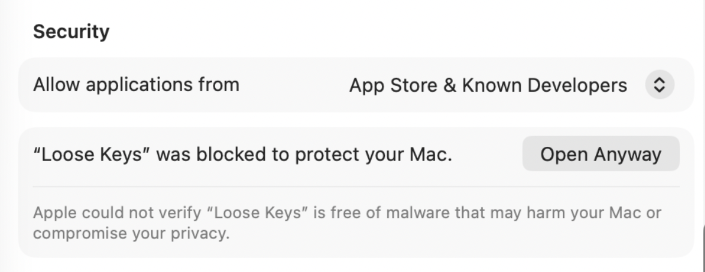

# Loose Keys

Loose Keys is a Mac app that watches your home folder, and any other folders
or drives you add, for credentials left in plain files: password exports,
private keys, API tokens, saved sign-ins, and secrets your AI agents leave
around. For each one it tells you what it found and how to take care of it.
It never connects to the network or changes the files it reads. It is in
English and Spanish.

Version 0.4.0, MIT licensed.

## Installing the beta

You need macOS 14 or later. Download the app from the
[latest release](https://github.com/chuglo/loose-keys/releases/latest), unzip
it and move **Loose Keys** to Applications. If the release includes a `.dmg`,
open it and drag **Loose Keys** onto its **Applications** shortcut, then eject
the disk and open the app from Applications.

While Loose Keys is in beta it isn't notarized by Apple, so macOS blocks it the
first time you open it. Click **Done**:



Then open **System Settings › Privacy & Security**, scroll to **Security**,
click **Open Anyway** beside the message about Loose Keys, and confirm:



Press **Scan Automatically** to have it keep watching after you close the
window, or **Scan Now** to check once.

## Building the app

You need Rust 1.88 or later and Apple's command-line developer tools.

```sh
sh gui/build-macos.sh
open "target/release/bundle/macos/Loose Keys.app"
```

To keep it, move it to Applications. To make a drag-to-Applications disk
image from that bundle, run `sh gui/package-dmg.sh`. It writes
`target/release/bundle/macos/Loose-Keys-<version>.dmg` and refuses to overwrite
an existing image.

## Command line

The app includes the `loose-keys` command, for a one-time scan from a
terminal or a script. Link it into a folder on your `PATH`:

```sh
ln -s "/Applications/Loose Keys.app/Contents/MacOS/loose-keys" /usr/local/bin/
loose-keys scan
```

It runs the app's scanner but doesn't read or keep the app's state, so
findings you set aside in the app are still reported there.

```sh
loose-keys scan --limits                  # also print what the scan can't detect
loose-keys scan --select /Volumes/Backup  # include another folder or drive
loose-keys scan --export report.json      # full JSON report
loose-keys scan --feedback counts.json    # counts only, no paths
loose-keys --list-rules                   # every rule and its advice
```

`--help` has the rest, including exit codes.

A full report contains file paths; a counts file leaves out paths but still
shows which kinds of credentials you have. Look before you share either one.

## Development

One Cargo workspace: the scanner is a library (`src/`) with the `loose-keys`
command on top, and `gui/` is the app's engine, linked into a Swift window.

Read [AGENTS.md](AGENTS.md) and
[standards](docs/development/standards.md) before changing
anything. Every check runs locally, and
[local checks](docs/testing/local-verification.md) lists them all.

- [Usage and detection limits](docs/usage.md)
- [All documentation](docs/README.md)
- [JSON report schema](schema/report-1.schema.json)
- [License](LICENSE) and [third-party notices](THIRD_PARTY_NOTICES)
